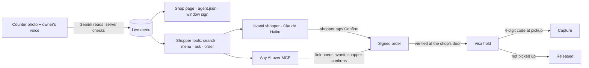

# avanti

**Open any small shop to AI shoppers.** One photo of the counter turns a corner shop into a shop that any AI shopper can find, order from and pay with Visa, with every order held until pickup.

*avanti* is Italian for "come in!", what you call out when someone knocks. It also means "forward".

**Live:** https://try-avanti.vercel.app · Built at DubHacks '26 for Visa's *Reimagine Shopping* track.

---

## Why

Shopping is moving into AI chats. Over 75% of shoppers have already used assistants like ChatGPT, Claude and Gemini to help them shop (Bloomreach, 2026), and Bain expects AI agents to drive $300–500B of US online sales by 2030. But an AI shopper can only buy from businesses that are plugged in: the big chains, with catalogs, APIs and checkout flows.

Small businesses are about half of US economic activity (Visa). The bakery near campus, the market stand, the home baker: they have a chalkboard, a cash box and a phone. To an AI shopper, they don't exist.

Everyone is building the AI that shops. avanti builds the other half: the shop that AI can buy from, set up in about a minute by someone who will never write an API.

## How it works

### For the shop: open in about a minute
- **Snap the counter** (or skip the photo). Gemini lists what it sees and reads prices straight off price tags and handwritten signs. Anything it can't price is marked *needs a price*. It never guesses.
- **Say what changed,** by voice or text, in any language: "I sold out of turkey jerky", "Monster is three dollars, the pistachios have nuts". Only what you mention changes, and every new price has to trace back to your own words.
- **One tap and you're open,** to walk-in customers and to every AI shopper. The shop gets a public page, a machine-readable `agent.json`, and a printable window sign with a QR code: *AI orders welcome.*

### Behind the counter (a live dashboard on a laptop or phone)
- New orders land live and are **read out loud**. The owner talks back: "we're out of croissants" marks them sold out for every AI shopper at once.
- **Rules for AI:** a spending limit per AI order, items that are in-person only, and a pause switch, all enforced before Visa is ever called.
- **What AI shoppers asked:** today's searches that found the shop, how many ordered, and what nearby shoppers wanted that the shop doesn't sell yet (counted anonymously).
- **Regulars:** a stamp card with the owner's own reward ("every 3rd pickup: a free cookie"). The counter says "Give: a free cookie" when one is due.

### For the shopper
- **Ask in plain words:** "Cake, flowers and a small print by 10 tonight, no nuts." avanti searches live shop data, checks allergens against each shop's own words, explains why it picked a shop, and can split one request across several shops with a single **Confirm all**.
- **A live pickup ticket:** a 4-digit code, a HELD seal ("not charged until you pick up"), and status that moves on its own (Sent → Preparing → Ready → Picked up). Tap **I'm here** and the counter announces you by name.
- **No account.** Stamp cards live on your phone. It also installs as a home-screen app.

### From any AI
avanti is also a remote **MCP server**, so Claude, Cursor or any MCP client can use the same shops. See [Use avanti from any AI](#use-avanti-from-any-ai).



## Built for trust

Letting AI near menus and money only works if the boundaries are hard. In avanti:
- **The AI never sets a price.** Prices always come from the database. A new price is accepted only if it traces to the owner's own words in that message, or to a price tag quoted from the photo.
- **No invented diet claims.** A "nut-free" or "vegan" tag needs a quote from the shop's own words, and shoppers see that quote.
- **A person confirms every order.** AI shoppers can search, ask and start an order, but nothing is held until the shopper taps Confirm. Over MCP, `start_order` returns a link and the shopper confirms in avanti.
- **Every AI order is signed.** The avanti shopper signs each order with its Ed25519 key, using RFC 9421 HTTP Message Signatures (the standard Visa's Trusted Agent Protocol builds on), with a content digest, a nonce and a timestamp. The shop checks it at the door before anything else happens. In the demo, 50 unsigned test bots were all turned away and 0 reached Visa.
- **Honest money states.** Held, charged and released are different promises, and the UI always says which one is true. Nothing is charged until pickup.
- **Privacy by default.** No shopper accounts. The stamp card uses a device key that's hashed before it leaves the phone. Owner links are secret tokens stored only as hashes. Insights are anonymous counts. The database is locked with row-level security and only the server can read it. [/privacy](https://try-avanti.vercel.app/privacy) explains, in plain words, how the AI is used and what data is kept.
- **Guard rails on a public demo.** Rate limits protect the AI quota and the sandbox, and shops made by visitors are private sandboxes.

## What it changes for a shop

- **A new channel with no integration:** a photo and a voice are the whole setup. No website, POS or catalog to build.
- **Faster service:** orders announce themselves, stock changes are one sentence, and shoppers say when they're at the door.
- **More completed orders:** multi-shop errands in one tap, allergen answers in the shop's own words, and pickup holds that make "I'll take it" stick.
- **Repeat customers:** stamp cards with no app or account.
- **Demand it can see:** what AI shoppers nearby asked for and couldn't find is a list of what to stock next.
- **Payment certainty:** the money is authorized when the order is placed and captured with the pickup code.

## How it's built

- **App:** Next.js 16 (App Router), React 19, Tailwind 4 and Motion; Supabase for Postgres, realtime and storage; deployed on Vercel.
- **Reading the counter:** Gemini (multimodal) reads the photo and the owner's voice or text, and returns structured items; for edits it returns only the changes. Server-side validation enforces the price and diet-tag rules above. It falls back across several Gemini models, and treats an empty read as a failed one.
- **The shopper:** Claude (Haiku) as a tool-using agent that searches shops, reads menus, asks the shop, proposes orders and plans multi-shop errands. Prices are always re-read from the database.
- **Any AI:** a remote MCP server (Streamable HTTP) over the same tools.
- **Signatures:** Ed25519 keys and RFC 9421 HTTP Message Signatures with Content-Digest, nonces and timestamps against replays; an agent directory holds the public keys.
- **Payments:** Visa Acceptance (Cybersource) REST sandbox: authorize with capture off (the hold), capture at pickup, reverse when a hold is released.
- **Live updates:** Supabase realtime broadcasts, with polling as a backup. Voice on the counter uses the browser's speech synthesis and recognition.
- **Quality:** strict TypeScript, ESLint, and 643 Vitest tests across the AI validation, signatures, Visa client, loyalty, insights and MCP server; a pre-commit hook blocks secrets.

| Folder | What's in it |
|---|---|
| `src/app` | Pages and API routes (shop setup, counter, shopper, ticket, orders, MCP) |
| `src/lib/ai` | Counter reading and edits (Gemini), the shopper agent (Claude), prompts |
| `src/lib/mcp` | The MCP server and its tools |
| `src/lib/trust` | Signing and verifying agent requests (RFC 9421) |
| `src/lib/visa` | The Cybersource client: authorize, capture, reverse |
| `src/lib/orders`, `src/lib/loyalty`, `src/lib/insights` | Orders and pickup, stamp cards, demand insights |
| `supabase/migrations` | Schema, row-level security, stats functions |

## Try it

- **https://try-avanti.vercel.app.** Choose **I'm the shop** to open your own private shop from a photo, or **I'm shopping** to ask for something nearby.
- **See both sides at once:** [/demo](https://try-avanti.vercel.app/demo) opens your own private copy of a demo shop: run its counter while you shop from it.
- Demo shops are labeled **demo** and their names are fictional. Payments use Visa sandbox test cards, so no real money moves.

## Use avanti from any AI

avanti is also a remote MCP server. Any MCP-capable assistant can find the shops near the UW campus, read their live menus, ask a shop about allergens, and start an order:

```
https://try-avanti.vercel.app/api/mcp
```

No sign-in. Tools: `search_shops`, `get_menu`, `ask_shop`, `start_order`. Nothing is paid from the chat: `start_order` returns a link that opens avanti with the order filled in, and you confirm there. A signed order places a Visa hold, charged only at pickup. Demo shops are labeled demo.

- **Claude:** Settings → Connectors → Add custom connector → paste the URL → Add. Custom connectors need a paid Claude plan. Then try "Find me a birthday cake with no nuts near UW and start an order."
- **Claude Desktop:** the same Connectors steps. On any plan you can instead add this to `claude_desktop_config.json` (Settings → Developer → Edit Config) and restart Claude:
  ```json
  { "mcpServers": { "avanti": { "command": "npx", "args": ["-y", "mcp-remote", "https://try-avanti.vercel.app/api/mcp"] } } }
  ```
- **Cursor:** add it to `~/.cursor/mcp.json` (or a project's `.cursor/mcp.json`):
  ```json
  { "mcpServers": { "avanti": { "url": "https://try-avanti.vercel.app/api/mcp" } } }
  ```
- **MCP Inspector:** run `npx @modelcontextprotocol/inspector`, pick Streamable HTTP, paste the URL, Connect. Or from a terminal:
  ```bash
  npx @modelcontextprotocol/inspector --cli https://try-avanti.vercel.app/api/mcp --transport http --method tools/list
  ```
- **Any other MCP client:** add the URL as a remote (Streamable HTTP) server with no auth.

## Run locally

```bash
pnpm install
cp .env.example .env.local   # fill in values (Gemini, Claude, Supabase, Visa sandbox)
pnpm db:migrate              # needs SUPABASE_DB_URL
pnpm keys:agent              # creates the shopper agent's signing key (never printed)
pnpm dev
pnpm check                   # typecheck, lint and tests
```

Without Visa sandbox keys, payments run in a clearly labeled **simulated** mode.

## What's next

- Visa Intelligent Commerce agent tokens instead of test cards, and registering the avanti shopper in Visa's agent directory.
- Instant payout to the owner at pickup with Visa Direct.
- Tap to pay at pickup on the owner's phone.
- Real shops on the Ave.

## Credits

Demo shops are labeled **demo** and their names are fictional. Payments use Visa sandbox test cards, so no real money moves.

| Shop | Photo | Credit |
|---|---|---|
| Mai's Bakery | Bakery display case with handwritten price cards | James Collington, [Pexels 31132630](https://www.pexels.com/photo/31132630/) |
| Ave Bakery | Whole chocolate cake on a glass stand | American Heritage Chocolate, [Unsplash Id8BO472TbY](https://unsplash.com/photos/Id8BO472TbY) |
| Góc Phố Market | Cozy corner of an Asian grocery store | Paolo Sanchez, [Pexels 34357798](https://www.pexels.com/photo/34357798/) |
| Petal Cart | Buckets of flowers outside a shop | Feyza Nur, [Pexels 9153436](https://www.pexels.com/photo/9153436/) |
| Cielito Taco Truck | Tacos on a table | Amar Preciado, [Pexels 18032209](https://www.pexels.com/photo/18032209/) |
| Tall Stack Books | A bookstore stall on a street | Ayman N. Yusuf, [Pexels 5810801](https://www.pexels.com/photo/5810801/) |
| Rabbit & Rook Prints | A wall of colorful art prints | Markus Spiske, [Unsplash dJo4Qhtu2sg](https://unsplash.com/photos/dJo4Qhtu2sg) |
| Sample on /open | "Phil's Fresh Squeezed Lemonade - 2023 Marin County Fair" | Sarah Stierch, [Wikimedia Commons](https://commons.wikimedia.org/wiki/File:Phil%27s_Fresh_Squeezed_Lemonade_-_2023_Marin_County_Fair_-_Sarah_Stierch.jpg), [CC BY 4.0](https://creativecommons.org/licenses/by/4.0/) |

Shop photos are used under the [Pexels License](https://www.pexels.com/license/) and the [Unsplash License](https://unsplash.com/license). Landing and brand media credits: `public/landing/CREDITS.md`, `public/brand/CREDITS.md`.
